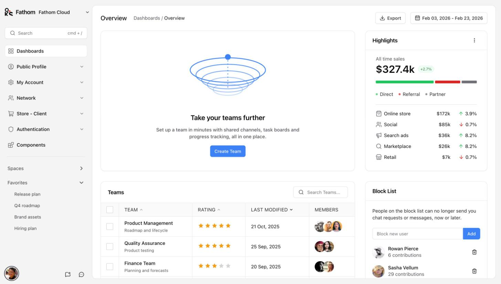
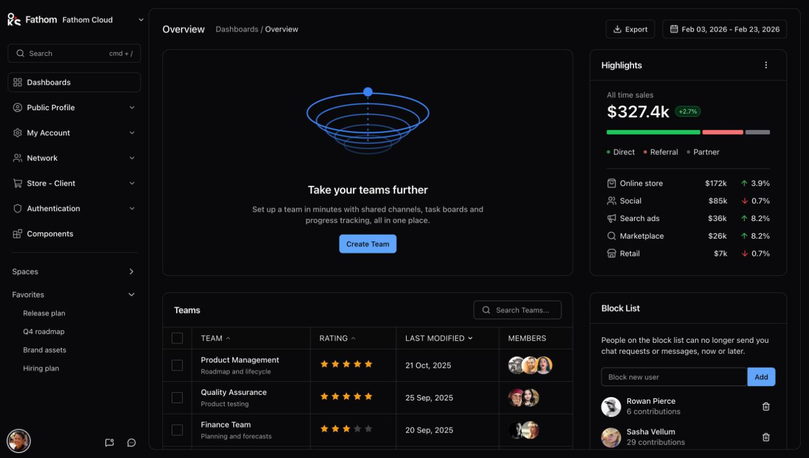
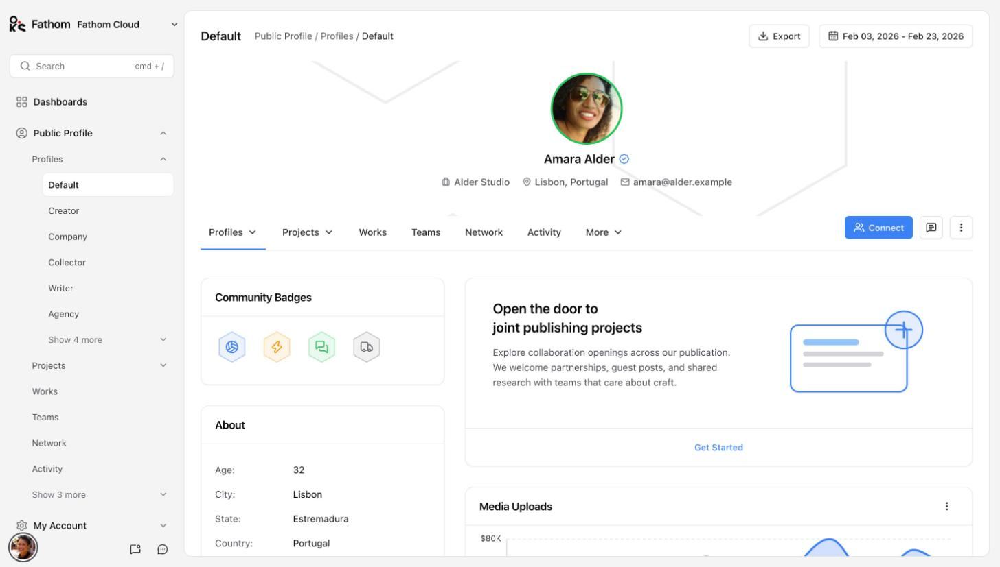
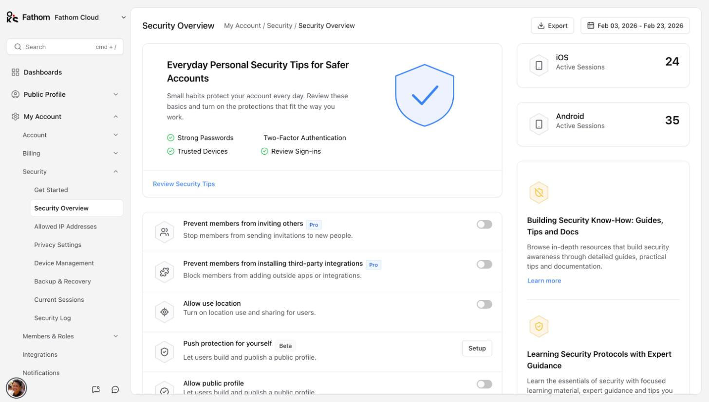
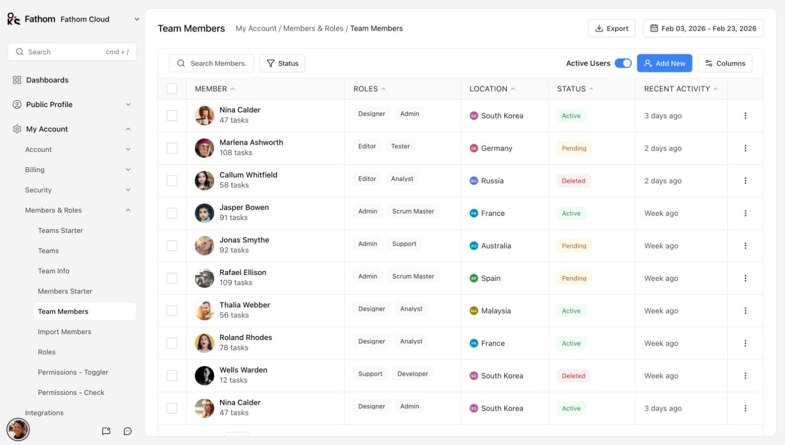
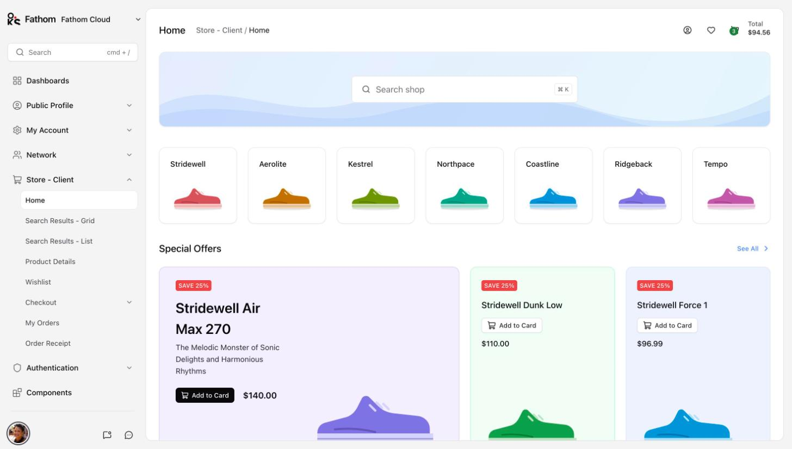
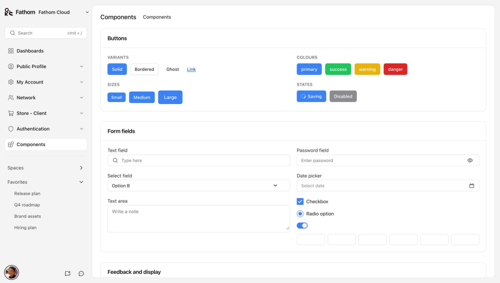
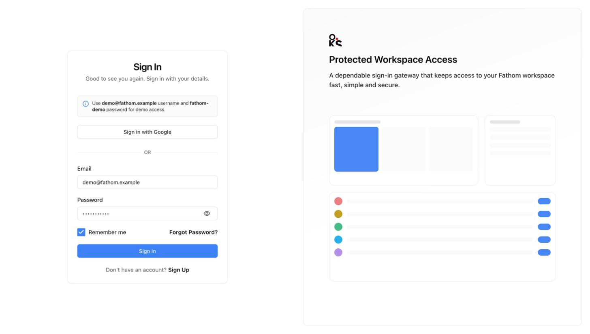

# Fathom

An admin template built entirely with [oks-ui](https://www.npmjs.com/package/oks-ui).

Fathom is a complete multi-page admin: a dashboard, public profiles, account and
security settings, billing, team and role management, a network directory, a
storefront with checkout, and the authentication flows. All of the interface is
oks-ui components; Tailwind CSS is used only for layout.

**[Live demo](https://oks-projects.github.io/fathom/)** · **[Repository](https://github.com/OKS-PROJECTS/fathom)**



## Screenshots

| | |
| --- | --- |
|  |  |
|  |  |
|  |  |
|  | |

## What is included

| Area | Pages |
| --- | --- |
| Dashboard | Overview with highlights, teams, block list and charts |
| Public Profile | 9 profile layouts, projects (2 and 3 columns), works, teams, network, activity, campaigns (card, list), empty state |
| My Account | Get started, user and company profile, four settings layouts, billing (basic, enterprise, plans, history), security (overview, allowed IPs, privacy, devices, backup, sessions, log), members and roles (teams, team info, members, import, roles, two permission views), integrations, notifications, API keys, appearance, invite a friend, activity |
| Network | Get started, five user-card layouts, six user tables |
| Store - Client | Home, search results (grid, list), product details, wishlist, four-step checkout, my orders, order receipt |
| Components | A gallery of the oks-ui components used across the template, at `/components` |
| Authentication | Classic and Branded sign in, sign up, two-factor, check email, reset password; welcome message; account deactivated; 404 and 500 |

Also included: a command palette for page search (`cmd + /`), light and dark
themes, and responsive layouts from phone to wide desktop.

## Stack

- Next.js (App Router) and TypeScript
- oks-ui for every UI component, including tables, charts, forms, drawers and modals
- Tailwind CSS v4 for layout only
- lucide-react for icons, date-fns for dates, clsx for class names

No other UI, chart or form library is used.

## Getting started

```bash
npm install
npm run dev
```

Open <http://localhost:3000>.

| Script | What it does |
| --- | --- |
| `npm run dev` | Start the development server |
| `npm run build` | Create a production build |
| `npm run start` | Serve the production build |
| `npm run lint` | Run ESLint |

## Project layout

```
src/
  app/            Routes. (app) holds pages inside the shell; auth and error pages are standalone
  components/
    shell/        Sidebar, header panels, search, user menu
    ui/           Shared building blocks: Surface (card), PageHeader, DataGridCard, ...
    dashboard/    account/    profile/    network/    store/    auth/    Page-level components
  data/           Navigation tree and sample data (all fictional)
  styles/         theme.css (tokens and oks-ui overrides) and shell.css (layout)
  lib/            Theme switching and avatar helper
```

## How the `ui/` layer works

Pages are assembled from a small set of building blocks in `src/components/ui`.
`Surface` wraps the oks-ui `Card` with the template's border-only look.
`PageHeader` and `Container` give every page the same title bar and width.
`DataGridCard` is a sortable, selectable table card with a rows-per-page footer.
Everything visual is driven by tokens in `src/styles/theme.css`, so retheming
means editing those tokens, not the components.

## Theming

Light and dark are switched with a `data-theme` attribute on the root element and
remembered in local storage. Colours come from CSS variables prefixed `--app-`
(surfaces, borders, text) on top of oks-ui's own tokens, which already invert
for dark mode.

## Sample data

All names, companies, addresses and figures are invented. Avatars load from a
public placeholder service; product and illustration art is generated in code.

## Changelog

See [CHANGELOG.md](CHANGELOG.md).

## License

MIT
